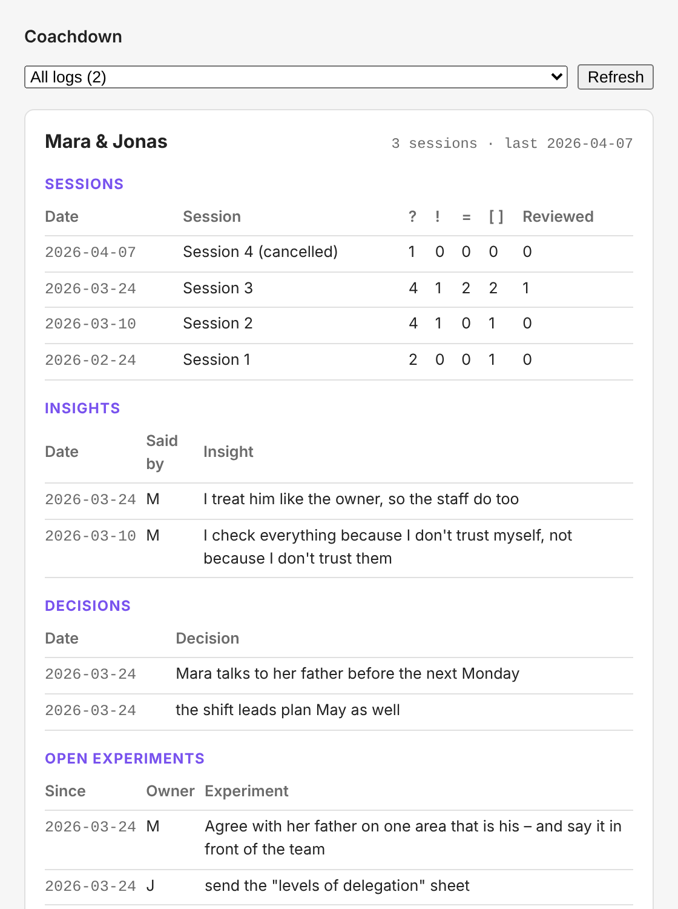

# Coachdown for Obsidian

> Full specification: https://github.com/sgalonska/coachdown/blob/main/SPEC.md · Plugin version **0.1.0** · Spec version **0.2.1 (draft)**

A few characters while you write. A live dashboard afterwards.

This folder contains three things that share one parser:

1. **An Obsidian plugin** that turns your Coachdown logs into a dashboard of sessions, insights, decisions and open experiments.
2. **The reference parser**, a small dependency-free TypeScript module that turns a Coachdown log into a structured record.
3. **A command-line tool** to inspect any log from the terminal.

Everything runs locally. The plugin makes no network requests and sends nothing anywhere.



*Rendered from the fictional examples in this repository.*

---

## Contents

- [What the plugin does](#what-the-plugin-does)
- [Install](#install)
- [Try it with the examples](#try-it-with-the-examples)
- [Use it](#use-it)
- [Command-line tool](#command-line-tool)
- [Use the parser in your own code](#use-the-parser-in-your-own-code)
- [What the parser understands](#what-the-parser-understands)
- [Known limitations](#known-limitations)
- [Development](#development)
- [Releasing a new version](#releasing-a-new-version)

---

## What the plugin does

| Feature | How to reach it |
| --- | --- |
| **Dashboard** of all logs: sessions, insights (`!!`), decisions (`=`), open experiments (`- [ ]`) | Ribbon icon, or command *Coachdown: Open dashboard* |
| **Dashboard inside any note** | A ` ```coachdown ` code block |
| **New session** at the top of the log, with open experiments copied into *Review* | Command *Coachdown: Insert new session* |
| **Structured record as JSON** for the current log | Command *Coachdown: Copy current log as JSON* |
| **Subtle highlighting** of coach lines, insights and decisions in reading view | On by default, see settings |

Click any row in the dashboard to jump to that line in the log.

An experiment counts as **open** until a later session reviews it as done (`- [x]` with the same text), usually in a *Review* section. Completion is not treated as success; the dashboard simply shows what hasn't been followed up yet.

---

## Install

You need **Obsidian 1.5 or newer** on desktop or mobile.

### Option A: from a GitHub release (no tools needed)

Use this once a release with the plugin files has been published.

1. Download `main.js`, `manifest.json` and `styles.css` from the latest release whose tag starts with `obsidian-v`.
2. In your vault, create the folder `.obsidian/plugins/coachdown/`. On macOS, press `Cmd + Shift + .` in Finder to show hidden folders like `.obsidian`.
3. Put the three files into that folder.
4. In Obsidian, go to **Settings → Community plugins**, turn off *Restricted mode* if it is on, click the reload icon next to *Installed plugins* and enable **Coachdown**.

### Option B: build from source

This takes about five minutes the first time.

1. **Install Node.js 18 or newer** from [nodejs.org](https://nodejs.org) (the LTS version is fine). Check it in a terminal:

   ```bash
   node --version
   ```

2. **Get the repository** and open this folder:

   ```bash
   git clone https://github.com/sgalonska/coachdown.git
   cd coachdown/tools/obsidian
   ```

3. **Install the build tools and build the plugin:**

   ```bash
   npm install
   npm run build
   ```

   This creates `main.js` (the plugin), `dist/cli.cjs` (the command-line tool) and `dist/coachdown.mjs` (the parser as a library).

4. **Copy the plugin into your vault.** Replace the path with the folder of your vault, the one that contains `.obsidian`:

   ```bash
   npm run install-plugin -- "/Users/you/Documents/My Vault"
   ```

5. **Enable it in Obsidian:** *Settings → Community plugins*, turn off *Restricted mode* if needed, reload the list and enable **Coachdown**.

To update later, run `git pull`, `npm run build` and step 4 again, then reload Obsidian.

---

## Try it with the examples

The fastest way to see what it does:

1. Copy the files from [`../../examples/`](../../examples/) into your vault, for example into a folder called `Coaching`.
2. Click the Coachdown icon in the left ribbon. The dashboard opens in the right sidebar.
3. Open `fictional-engagement.coach.md` and run *Coachdown: Insert new session*. A new session appears on top, with the open experiments already listed under *Review*.

All examples are fictional.

---

## Use it

### Which notes count as logs

A note is a Coachdown log if

- its file name ends in `.coach.md`, for example `Mara & Jonas.coach.md`, **or**
- its front matter contains a `coachdown:` key, for example `coachdown: 0.2.1`.

You can change the suffix, turn off front-matter detection or limit the search to one folder in *Settings → Coachdown*.

### The dashboard view

Open it with the ribbon icon or *Coachdown: Open dashboard*. Pick one log or *All logs* at the top. With all logs selected, each panel shows the five most recent rows. It refreshes automatically when a log changes.

### A dashboard inside a note

Put a code block like this into any note, for example a `Coaching dashboard.md`:

````markdown
```coachdown
show: insights, experiments
source: all
limit: 10
```
````

| Option | Values | Default |
| --- | --- | --- |
| `show` | any of `sessions`, `insights`, `hypotheses`, `decisions`, `experiments` | `sessions, insights, decisions, experiments` |
| `source` | `auto`, `this`, `all`, a note name such as `[[Mara & Jonas.coach]]`, or a folder path such as `Coaching/2026` | `auto`: the current note if it is a log, otherwise all logs |
| `limit` | rows per panel, `0` for no limit | `0` |

An empty code block (` ```coachdown ` followed by ` ``` `) inside a log shows the full dashboard for that log, which works well at the top of each log.

`hypotheses` lists insights that were voiced by the coach (`J: … !!`). The spec treats those as hypotheses, not as the coachee's insights.

### Insert a new session

Run *Coachdown: Insert new session* while a log is open. It adds a dated session block with *Since last time*, *Review*, *Discussion* and *Experiments*:

- in `newest-first` logs (the default) above the latest session, in `oldest-first` logs at the end,
- with the next session number,
- with every open experiment copied into *Review*, so you remember to ask about it.

Tip: assign a hotkey to this command in *Settings → Hotkeys*.

### Copy as JSON

*Coachdown: Copy current log as JSON* puts the full structured record of the current log on your clipboard: sessions, sections and one entry per line with speaker, type, parent and whether the speaker was marked or inferred. The format is described in [What the parser understands](#what-the-parser-understands).

### Reading view highlighting

In reading view, list items in logs get light visual cues: coach lines in the accent colour, a coloured bar for insights and decisions. Turn it off in the settings if you prefer plain notes.

---

## Command-line tool

After `npm run build`, the command-line tool works on any log:

```bash
node dist/cli.cjs ../../examples/fictional-engagement.coach.md --summary
```

```text
date        status     items  coach  coachee  ?   !!  =   [ ]  reviewed
2026-02-24  held          12       3         9    2    0    0     1          0
2026-03-10  held          12       4         8    4    1    0     1          0
2026-03-24  held          23       6        14    4    1    2     2          1
2026-04-07  cancelled      2       0         2    1    0    0     0          0
```

| Option | Output |
| --- | --- |
| *(none)* | the full structured record as JSON |
| `--summary` | one line per session with counts |
| `--insights` | all coachee insights with session date and speaker |
| `--experiments` | open experiments with owner |
| `--decisions` | all decisions |
| `--compact` | JSON without indentation |

You can pass several files at once. To use it as a global `coachdown` command, run `npm link` once in this folder.

---

## Use the parser in your own code

`dist/coachdown.mjs` is the parser as an ES module with no dependencies. It runs in Node.js, browsers and other editors.

```js
import { parseCoachdown, openExperiments, summarise } from './dist/coachdown.mjs';

const doc = parseCoachdown(markdown);
doc.sessions;            // [{ date: '2026-03-24', title: 'Session 3', status: 'held', … }]
doc.items;               // [{ text, speaker, speakerMarked, type, mode, parent, session, … }]
openExperiments(doc);    // experiments not yet reviewed as done
summarise(doc);          // counts per session
```

The TypeScript sources are in [`src/parser.ts`](src/parser.ts) and [`src/session.ts`](src/session.ts), with types for every field.

---

## What the parser understands

It implements the writing format of **Coachdown 0.2.1**:

| Spec | Supported |
| --- | --- |
| Front matter: `participants` (short and long form, names, aliases), `default_speaker`, `order` | ✓ |
| `About this log` section instead of front matter (`- participants: J = coach (Jonas), N = coachee (Nora)`) | ✓ |
| Session headings of any level with ISO, `Mar 10, 2026`, `10 Mar 2026`, `10. März 2026` and `10.03.2026` dates | ✓ |
| Session title, calendar links, status such as `(cancelled)` or `(nicht stattgefunden)` | ✓ |
| Session metadata line: `time`, `type`, `participants`, `topics` | ✓ |
| Interview sessions: unmarked lines belong to the interviewee | ✓ |
| Standard sections in English and German with their default speakers | ✓ |
| Section default (`### J: Title`) and perspective sections (`### Perspective: …`) | ✓ |
| Speaker tags, names and aliases; `Coach:` / `Coachee:` without front matter | ✓ |
| Quotes, third-party quotes (`"…" — her father`), questions, `!!`, `=`, `- [ ]` / `- [x]`, `learned:` | ✓ |
| Coach insights recorded as hypotheses | ✓ |
| Indentation as parent relation, empty labels (`- J:`) applying to nested items | ✓ |
| Blockquotes, tables and images as material; `[AI]` as generated material | ✓ |
| `#themes` | ✓ |
| Google Docs export artefacts (`- > text`) | ✓ |

Each item in the record has:

| Field | Meaning |
| --- | --- |
| `session`, `section`, `sectionKind` | where the line is |
| `text`, `raw`, `line` | the text without markers, the original line, the line number |
| `speaker`, `speakerName`, `speakerMarked` | who said it, and whether that was marked or inferred |
| `mode` | `verbatim` or `note` |
| `type` | `note`, `question`, `insight`, `hypothesis`, `decision`, `experiment`, `review`, `backlog`, `material`, `generated` |
| `owner`, `done`, `learned`, `reviewOf` | for experiments and reviews |
| `parent`, `depth` | the item it is nested under |
| `themes` | `#tags` |

---

## Known limitations

- **No confidence scores yet.** The record says whether a speaker was marked or inferred, but not how sure the inference is. A future version or an AI agent can add that.
- **Highlighting only in reading view.** Live Preview and source mode show your notes unchanged.
- **Reviews are matched by text.** A review closes an experiment when the text is the same or one starts with the other. Rewording an experiment between sessions keeps it open.
- **Front matter is read with a small built-in reader** that covers the Coachdown keys, not full YAML.
- **Counts are counts.** Numbers like "lines by coach" describe the notes, not the conversation. They are a starting point for reflection, not a measure of coaching quality.

Found a case it gets wrong? Open an issue with a small, **fictional** example. Never post real session notes.

---

## Development

```bash
npm install
npm run dev      # rebuilds main.js and the CLI on every change
npm test         # type-checks, builds and runs the tests against ../../examples
```

For a fast loop, symlink this folder into a test vault, keep `npm run dev` running and run *Reload app without saving* from Obsidian's command palette after a change:

```bash
ln -s "$(pwd)" "/path/to/test-vault/.obsidian/plugins/coachdown"
```

| Path | Content |
| --- | --- |
| `src/parser.ts` | the reference parser, no dependencies |
| `src/session.ts` | planning a new session block |
| `src/render.ts` | dashboard rendering with plain DOM APIs |
| `src/main.ts` | the Obsidian plugin: views, commands, code block, settings |
| `src/cli.ts` | the command-line tool |
| `src/index.ts` | library entry point |
| `test/parser.test.mjs` | tests against the fictional examples |
| `scripts/install-plugin.mjs` | copies the build into a vault |
| `esbuild.config.mjs` | builds `main.js`, `dist/cli.cjs` and `dist/coachdown.mjs` |
| `obsidian-release.yml` | GitHub workflow that publishes a release, see below |

---

## Releasing a new version

One-time setup: GitHub only runs workflows from the repository root, so copy the workflow there once:

```bash
cd coachdown
mkdir -p .github/workflows
cp tools/obsidian/obsidian-release.yml .github/workflows/
```

Then, for each release:

1. Update `version` in `manifest.json` and `package.json`, and add the version to `versions.json` with the minimum Obsidian version.
2. Commit, then tag with the `obsidian-v` prefix and push the tag:

   ```bash
   git tag obsidian-v0.1.0
   git push origin obsidian-v0.1.0
   ```

3. The GitHub workflow in `.github/workflows/obsidian-release.yml` runs the tests, builds the plugin and attaches `main.js`, `manifest.json` and `styles.css` to a new release. Option A of the install instructions then works.

Installing through BRAT or listing the plugin in Obsidian's official community directory additionally requires a `manifest.json` at the repository root, and for the directory a review by the Obsidian team. That is a later step.

---

## License

MIT, see [`../../LICENSE`](../../LICENSE). The Coachdown specification itself is CC BY 4.0.
